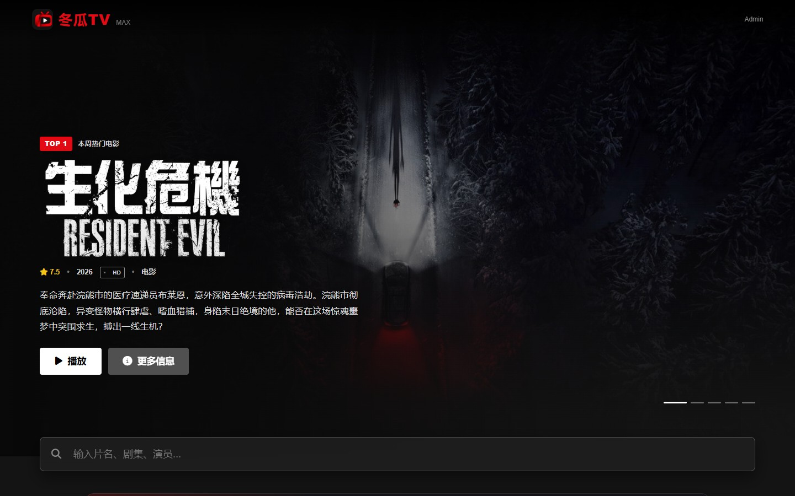
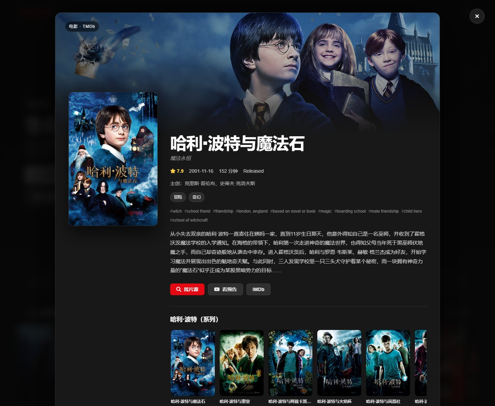
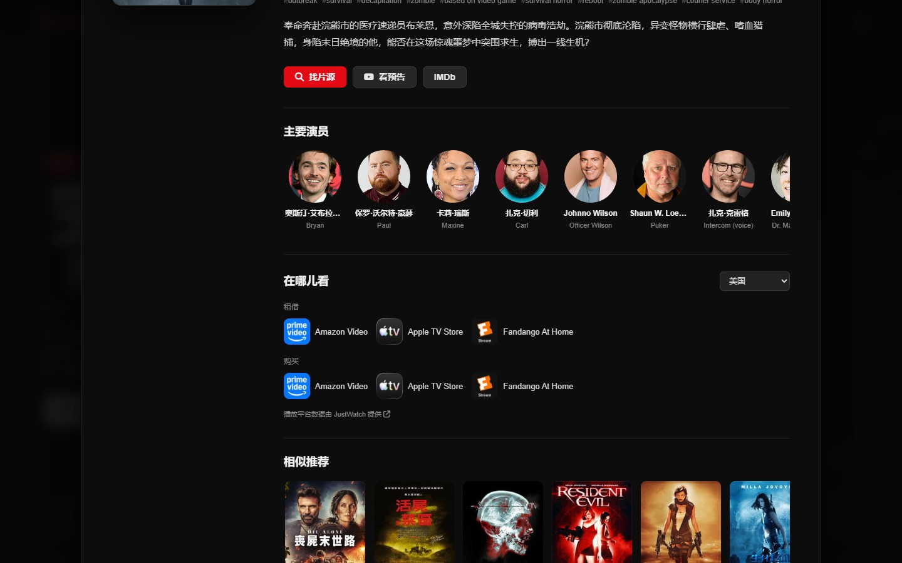
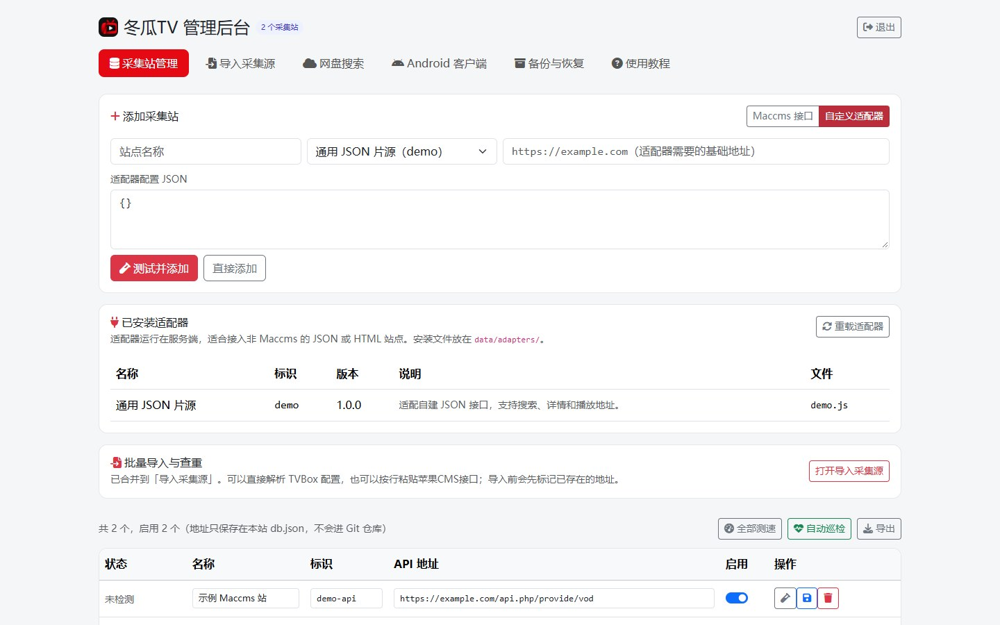
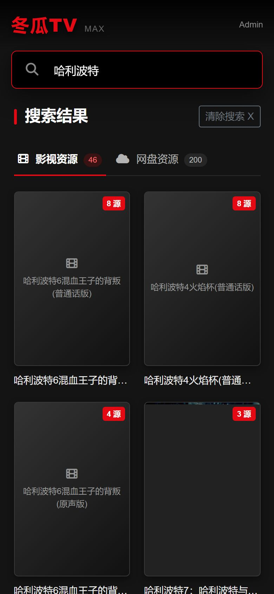
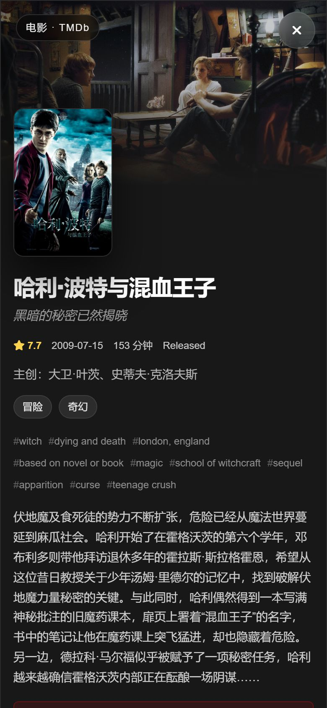

# 冬瓜TV

[](https://github.com/Minerchu/dongguaTV/stargazers)
[](https://github.com/Minerchu/dongguaTV/forks)
[](https://github.com/Minerchu/dongguaTV/commits/main)
[](LICENSE)

> Star 和 Fork 由 GitHub 实时更新。GitHub 不公开自建服务的安装次数；Docker Pulls 需要发布 Docker Hub 官方镜像后才会产生。

基于 Node.js 的影视聚合站：TMDb 提供首页推荐和海报，Maccms 采集站提供搜索与播放，PanSou 提供网盘资源搜索。

- 在线教程：https://minerchu.github.io/dongguaTV/
- 后台入口：`http://服务器IP:3000/admin.html`
- 技术栈：Node.js + Express，前端 Vue 3 + Bootstrap（CDN）

## 界面预览

| 首页推荐 | TMDb 影视详情 |
| --- | --- |
|  |  |

| 播放平台与推荐 | 可视化后台 |
| --- | --- |
|  |  |

| 手机端搜索 | 手机端详情 |
| --- | --- |
|  |  |

更多移动端和后台教程截图见[在线教程](https://minerchu.github.io/dongguaTV/#preview)。

## 功能

- **多源聚合搜索**：并发查询多个 Maccms V10 JSON 接口，同一影片的多条线路自动合并。
- **线路延迟显示**：详情页对每条线路调用测速接口，用颜色标示响应速度。
- **TMDb 首页推荐**：本周趋势、华语、日韩、港台、正在热映、高分电影、今日播出。
- **TMDb 影视详情**：演员、主创、分级、关键词、系列作品、YouTube 预告、相似推荐和分地区播放平台。
- **搜索结果接 TMDb**：点击聚合搜索结果先显示影片资料，再选择播放线路，不再直接跳进播放器。
- **TMDb 一键找片源**：详情页可直接用片名发起 Maccms 聚合搜索，同时查询 PanSou 网盘资源。
- **可分享的页面地址**：搜索、影视详情和播放页分别有独立 URL，刷新和浏览器前进/后退都能恢复。
- **TMDb 同源反代**：内置 `/tmdb` 代理，不需要自己的反代域名，前端也不会暴露 Key。
- **网盘资源搜索**：接入 [PanSou](https://github.com/fish2018/pansou) 后，搜索结果页增加「网盘资源」标签。
- **可视化后台**：添加、测试、编辑、启停、删除、批量导入采集站，不用手改文件。
- **后台使用教程**：内置接口格式、谷歌搜索关键词、验证方法和常见问题。
- **PanSou 配置**：后台可填写地址和 Token，并测试连通性。
- **不内置采集站**：仓库和正式版不包含任何第三方采集站地址。
- **配置持久化**：站点和设置保存在 JSON 文件；Docker 使用 `data/` 目录或数据卷。
- **后台鉴权**：HttpOnly Cookie 或 `X-Admin-Token`，登录失败有频率限制。

## 快速开始

### 方式一：Docker Compose（推荐）

要求：Docker 20.10+，Docker Compose v2。

```bash
git clone https://github.com/Minerchu/dongguaTV.git
cd dongguaTV
cp .env.example .env
# 编辑 .env：至少修改 ADMIN_PASSWORD，并填写 TMDB_API_KEY
docker compose up -d --build
```

启动后访问：

- 主站：`http://服务器IP:3000`
- 后台：`http://服务器IP:3000/admin.html`
- 配置：`./data/db.json`

Compose 会同时启动主站和 PanSou。PanSou 只在 Compose 内部网络访问，不需要向公网开放 `8888` 端口。

### 方式二：单容器 All-in-One

适合宝塔、1Panel 等不方便使用 Compose 的面板。主站和 PanSou 运行在同一个容器里。

```bash
docker build -f Dockerfile.allinone -t dongguatv:allinone .

docker run -d --name dongguatv \
  -p 3000:3000 \
  -v dongguatv-data:/app/data \
  -e ADMIN_PASSWORD=改成你的密码 \
  -e TMDB_API_KEY=你的TMDb密钥 \
  dongguatv:allinone
```

> 不挂载 `/app/data` 也能启动，但删除容器后采集站配置会一起丢失。

### 方式三：Node.js 直接运行

要求：Node.js 18+，推荐 20 / 22。

```bash
git clone https://github.com/Minerchu/dongguaTV.git
cd dongguaTV
npm install
cp .env.example .env
# 编辑 .env：填写 ADMIN_PASSWORD、TMDB_API_KEY，可选 PANSOU_URL
npm start
```

TMDb Key 由服务端读取，前端不需要修改，也不会把 Key 写进网页源码。

## 第一次使用

1. 打开 `http://服务器IP:3000/admin.html`。
2. 输入管理员密码。默认是 `admin`，部署到公网前必须通过 `ADMIN_PASSWORD` 修改。
3. 在「采集站管理」填写站点名称和 Maccms JSON 接口地址，点「测试并添加」。
4. 打开「使用教程」可查看接口格式、谷歌搜索关键词和验证方法。
5. 网盘搜索：Compose / All-in-One 已自动连接 PanSou；Node.js 部署需要在后台「网盘搜索」填写地址，或配置 `PANSOU_URL`。

## 页面地址

页面不再始终停留在同一个地址。现在站内操作会同步更新浏览器地址栏：

| 页面 | 地址示例 |
| --- | --- |
| 首页 | `http://服务器IP:3000/` |
| 搜索 | `http://服务器IP:3000/search?wd=庆余年` |
| 电影详情 | `http://服务器IP:3000/title/movie/671` |
| 剧集详情 | `http://服务器IP:3000/title/tv/1399` |
| 播放页 | `http://服务器IP:3000/watch?name=片名&site=站点key&id=影片ID` |

这些地址可以直接刷新、复制分享，浏览器前进和后退也能恢复对应页面。Docker 对外端口由 `HOST_PORT` 决定；如果不希望在网址里看到 `:3100`，需要使用 Nginx / Caddy 把域名的 80/443 转发到这个端口，详见[修改端口与反向代理](https://minerchu.github.io/dongguaTV/#ports)。

## TMDb 反代（默认零配置）

Docker Compose 和 All-in-One 都已经内置同源反代，**不需要自己的域名、Cloudflare Worker 或其他额外服务**：

- 前端请求 `/tmdb/3/...`，`server.js` 转发到 `https://api.themoviedb.org/3/...`
- 海报请求 `/tmdb/t/p/...`，`server.js` 转发到 `https://image.tmdb.org/t/p/...`
- `TMDB_API_KEY` 只保存在服务端，不会出现在浏览器源码里

请求链路就是同一个端口，不需要额外 IP 或端口：

```text
浏览器 → http://服务器IP:3000/tmdb/... → 容器内 server.js → TMDb
```

用户只需要在 `.env` 或容器环境变量里填 `TMDB_API_KEY`。默认**不要填** `HTTPS_PROXY`、`TMDB_API_BASE`、`TMDB_IMAGE_BASE`，也不需要额外启动反代容器。

程序内置了自动备用域名：主域名超时或返回 5xx 时会自动切换，不需要用户处理。修改 Docker 对外端口（例如 `8080:3000`）也不会影响反代，因为前端始终请求当前访问地址下的 `/tmdb/...`。

只有服务器本身访问不了 TMDb（例如国内服务器）时，才需要下面的可选设置：

1. 在 `.env` 里填写代理：

```env
HTTPS_PROXY=http://host.docker.internal:7890
HTTP_PROXY=http://host.docker.internal:7890
```

`host.docker.internal` 指向宿主机，Compose 已经配置好映射。
All-in-One 则直接把同样的变量写成 `-e HTTPS_PROXY=...`。

只要宿主机能访问 TMDb，容器就能直接使用，不需要再搭建任何外部反代。

### 前台已经使用的 TMDb 数据

- 首页：本周趋势、华语剧集、日韩剧集、港台电影、正在热映、高分电影、今日播出。
- 详情面板：海报、背景图、评分、上映日期、片长、分级、类型、关键词、主创和演员。
- 系列作品：电影属于某个系列时，会展示该系列的其他作品，并可继续打开详情。
- 预告片：优先选择 YouTube 官方预告，没有预告的新片会自动隐藏按钮。
- 播放平台：按浏览器地区显示 Netflix、Disney+ 等平台，也可在详情面板手动切换地区。
- 相似推荐：展示 TMDb 推荐影片；点击“找片源”会带上片名回到聚合搜索。
- 图片和接口都走本站 `/tmdb/...`，浏览器端不会拿到 API Key。

采集站和网盘资源仍由项目自己的搜索接口提供，TMDb 只负责资料、图片和推荐，不存储任何影视文件。

## 修改端口

先记住：`ports` 左边是宿主机端口，右边是容器端口。

### 只改访问端口

推荐在 `.env` 里改 `HOST_PORT`，容器内部端口和内置反代都不用动：

```env
HOST_PORT=8080
```

```bash
docker compose up -d
```

也可以直接改 `docker-compose.yml`：

```yaml
# docker-compose.yml
ports:
  - "8080:3000"
```

```bash
docker compose up -d
```

之后访问 `http://服务器IP:8080`，程序内部仍然是 `3000`。

### 同时修改容器内部端口

```yaml
ports:
  - "8080:8080"
environment:
  - PORT=8080
```

```bash
docker compose up -d
```

### All-in-One 修改端口

```bash
docker run -d --name dongguatv \
  -p 8080:8080 \
  -e PORT=8080 \
  -v dongguatv-data:/app/data \
  -e ADMIN_PASSWORD=你的密码 \
  dongguatv:allinone
```

### Node.js 修改端口

修改 `.env`：

```env
PORT=8080
```

完整说明（含 PanSou 端口和 Nginx 反向代理）：[教程站 · 修改端口](https://minerchu.github.io/dongguaTV/#ports)

## 采集站

仓库不包含任何采集站地址。新安装启动后站点列表为空，需要自行添加。

接口地址通常以这些形式结尾：

```text
https://example.com/api.php/provide/vod
https://example.com/inc/apijson.php
```

验证方法：在浏览器里给地址加上 `?ac=list&pg=1`，能返回包含 `list` 的 JSON 才可用。

可以在 Google 搜索这些关键词：

- `"api.php/provide/vod"`
- `inurl:"api.php/provide/vod"`
- `"inc/apijson.php"`
- `maccms 采集接口`

添加后的地址只保存在服务器本地：

- 非 Docker：`db.json`，或 `DB_PATH` 指定的文件
- Docker Compose：`data/db.json`
- All-in-One：`/app/data/db.json`，建议挂载数据卷

`db.json` 和 `data/` 已加入 `.gitignore`，不会提交到 GitHub。旧版本代码中的 32 个站点只存在于 git 历史，不会随新版本分发。

批量导入格式，每行一个：

```text
我的资源站,https://example.com/api.php/provide/vod
另一个站,https://example.org/inc/apijson.php
```

## 配置

| 变量 | 默认值 | 说明 |
| --- | --- | --- |
| `PORT` | `3000` | Web 服务端口 |
| `DB_PATH` | `./db.json` | 配置文件路径；Docker 镜像默认 `/app/data/db.json` |
| `ADMIN_PASSWORD` | `admin` | 后台密码，公网部署必须修改 |
| `TMDB_API_KEY` | 空 | TMDb Key；由服务端 `/tmdb` 代理使用，不暴露到前端 |
| `TMDB_API_BASE` | `https://api.themoviedb.org/3` | TMDb API 上游，可换成自己的反代 |
| `TMDB_IMAGE_BASE` | `https://image.tmdb.org/t/p` | TMDb 图片上游，可换成自己的反代 |
| `TMDB_TIMEOUT` | `15000` | TMDb 请求超时（毫秒） |
| `TMDB_LANGUAGE` | `zh-CN` | TMDb 默认语言 |
| `PANSOU_URL` | 空 | PanSou 地址，例如 `http://pansou:8888` |
| `PANSOU_TOKEN` | 空 | PanSou 开启认证时的 Token |
| `PANSOU_USER` / `PANSOU_PASS` | 空 | 用账号密码自动换取 Token |
| `SEARCH_TIMEOUT` | `6000` | 单站搜索超时（毫秒） |
| `TEST_TIMEOUT` | `5000` | 添加站点时测试超时（毫秒） |
| `PANSOU_TIMEOUT` | `15000` | 网盘搜索超时（毫秒） |

后台填写的 PanSou 地址和 Token 优先于环境变量；`PANSOU_URL` 适合 Docker / 面板统一配置。

## 数据与备份

配置文件包含采集站、PanSou 地址和开关。备份时只需要保存这个文件：

```bash
# 容器正在运行时
docker cp dongguatv:/app/data/db.json ./db.json.bak
```

从旧版本迁移时，如果原配置在容器里的 `/app/db.json`，需要放到宿主机的 `data/db.json`，新版默认读取 `/app/data/db.json`：

```bash
mkdir -p data
docker cp dongguatv:/app/db.json ./data/db.json
```

### 更新版本

```bash
git pull origin main
docker compose up -d --build
```

`data/db.json` 不受影响，采集站配置会保留。

## API

### 公共接口

```text
GET /api/config                 前台配置（网盘开关、启用站点数）
GET /api/sites                  站点列表（含启用状态）
GET /api/check?key=站点key       测试单个站点
GET /api/hot                    从已启用站点获取最近 24 小时更新
GET /api/search?wd=关键词        聚合搜索
GET /api/detail?site_key=&id=   影片详情
GET /api/cloud/search?wd=关键词  网盘搜索
```

### 管理接口

需要先登录，使用 `dg_admin` Cookie 或 `X-Admin-Token`：

```text
POST   /api/admin/login
POST   /api/admin/logout
GET    /api/admin/me
GET    /api/admin/sites
POST   /api/admin/sites
PUT    /api/admin/sites/:key
DELETE /api/admin/sites/:key
POST   /api/admin/sites/test
POST   /api/admin/sites/import
PUT    /api/admin/settings
POST   /api/admin/pansou/test
```

登录失败 10 分钟内最多 8 次，超过后返回 `429`。

## 项目结构

```text
server.js              Express 服务、TMDb / 采集站 / PanSou 代理、后台鉴权
public/index.html      前台页面
public/admin.html      后台页面
public/style.css       前台样式
docs/                  GitHub Pages 教程站
Dockerfile             Compose 使用的主站镜像
Dockerfile.allinone    主站 + PanSou 单容器镜像
docker-compose.yml     Compose 部署
entrypoint*.sh         容器启动脚本
data/                  运行时数据（不提交）
```

## 常见问题

### 搜索没有结果？

先在后台确认采集站已添加并启用，再点「测试」确认接口返回 JSON。

### 添加站点提示不是 Maccms JSON 接口？

地址可能少了 `/api.php/provide/vod`，或者返回的是网页、XML。用 `?ac=list&pg=1` 在浏览器验证。

### 搜索很慢？

关闭响应慢的站点，或减少启用数量。默认单站 6 秒超时，可用 `SEARCH_TIMEOUT` 调整。

### 忘记后台密码？

修改 `ADMIN_PASSWORD` 后重启容器。

### 网盘搜索显示不可用？

检查 PanSou 是否运行、服务器能否访问 Telegram、代理是否正确。Compose 默认使用内部地址 `http://pansou:8888`。

### TMDb 首页没有内容？

确认 `.env` 里填了 `TMDB_API_KEY`。如果服务器访问不了 TMDb，配置 `HTTPS_PROXY`，或把 `TMDB_API_BASE` / `TMDB_IMAGE_BASE` 换成你的反代地址。

### 更新后采集站不见了？

确认 `data/db.json` 已挂载；旧版本的 `/app/db.json` 需要迁移到 `data/db.json`。

### 3000 端口被占用？

参考[修改端口](#修改端口)，只改宿主机端口即可。

## 安全建议

- 公网部署前必须修改 `ADMIN_PASSWORD`。
- 建议使用 Nginx / Caddy 配置 HTTPS。
- 不要把 `db.json`、`.env` 或采集站地址提交到仓库。
- 定期更新依赖并备份数据。

## 免责声明

本项目仅用于 Node.js 学习和接口聚合研究，不存储、不发布、不参与任何影视内容的制作与传播。采集站和网盘资源均由第三方提供，请只接入你有权使用的接口，并遵守当地法律法规。请支持正版。

## License

MIT License，详见 [LICENSE](LICENSE)。
